# Comparación de métodos de búsqueda de raíces
 
Evaluación 2 de Computación Numérica, Universidad Católica del Maule. Modalidad individual.
 
Se estudian las seis funciones propuestas en el enunciado con datos obtenidos al ejecutar los seis métodos: bisección, falsa posición, punto fijo, secante, Newton-Raphson clásico y Newton-Raphson mejorado. La variante del último se toma de la Clase 4 (trabajo autónomo) y del Tema N°2 de la asignatura, donde se denomina Newton-Raphson modificado.
 
## 1. Ambiente controlado y demostración de las raíces
 
Todas las ejecuciones utilizan tol = 1e-6 y un máximo de 100 iteraciones. Se conserva exactamente el criterio del profesor: |f(x_n)| < tol **o** |x_n - x_(n-1)| < tol, con desigualdad estricta. Las iteraciones cuentan aproximaciones nuevas que pudieron evaluarse; una estimación inicial aceptada tiene cero actualizaciones. En secante, el historial empieza con x1 en la fila n=0; x0 también participa en la fórmula y queda declarado en el ambiente.
 
Para f(x)=cos(x)-x desde x0=0.5, punto fijo termina en 33 pasos con el criterio del Word: el residuo es 7.709558e-7, aunque el paso todavía es 1.144510e-6. Si la parada se hace solo por diferencia entre iteraciones, este mismo ejemplo requiere 34 actualizaciones; la diferencia con las 33 se debe al criterio de parada.
 
### Variante de Newton mejorado
 
La fórmula indicada en clases es:
 
```text
D = [f'(x)]² - f(x) f''(x)
x siguiente = x - f(x) f'(x) / D
```
 
 
Se obtiene al aplicar Newton a mu(x)=f(x)/f'(x) y no exige conocer la multiplicidad. En el proyecto se llama Newton mejorado para mantener el nombre del Word. Se comprueban las derivadas y que D sea finito y distinto de cero. Si la primera derivada es cero sin alcanzar la tolerancia del residuo, se registra un error: mu no está definida y una corrección nula podría producir una falsa parada por paso cero. Una raíz inicial aceptada se reconoce antes de dividir.
 
| Función | Intervalo | x0 de Newton y punto fijo | Datos de secante | f(a) · f(b) | Raíz de referencia aproximada |
|---|---|---:|---|---:|---:|
| x³ − x − 2 | [1, 2] | 1.5 | 1, 2 | −8 | 1.521379706805 |
| (x − 2)² | [1, 3], auxiliar | 1.2 | 1.2, 1.3 | 1 | 2 |
| ln(x) + x − 4 | [2, 3] | 2.5 | 2, 3 | −0.128871747477 | 2.926271062444 |
| exp(−x) − x | [0, 1] | 0.5 | 0, 1 | −0.632120558829 | 0.567143290410 |
| cos(x) − x | [0, 1] | 0.5 | 0, 1 | −0.459697694132 | 0.739085133215 |
| √x − cos(x) | [0.1, 1] | 0.55 | 0.1, 1 | −0.312031945571 | 0.641714370873 |
 
Las cinco funciones con raíz simple son continuas en sus intervalos y tienen productos negativos en los extremos. El teorema de Bolzano garantiza al menos una raíz interior. Además, sus derivadas conservan el signo: la polinómica, la logarítmica y la mixta son crecientes; la exponencial y la trigonométrica son decrecientes. Por tanto, la raíz en cada intervalo es única. El logaritmo exige x > 0; la raíz cuadrada admite x >= 0, pero sus derivadas usadas por Newton requieren x > 0. Los ángulos se expresan en radianes.
 
En el caso doble, f(2)=0, f'(2)=0, f''(2)=2 y f(x)>=0. Hay una raíz de multiplicidad dos y tangencia al eje, sin cruce. El valor x0 = 1.2 del Word se interpreta como decimal 1.2. El intervalo auxiliar [1,3] sirve para dibujar la tangencia y comprobar que los métodos cerrados no cumplen su requisito. Para secante se declara adicionalmente x1=1.3, que evita inicialmente valores iguales de la función.
 
Las referencias se comprueban por separado con las funciones de math y hasta 80 pasos de bisección, sin utilizar las funciones de los métodos evaluados. Se guardan en [referencias.csv](src/data/referencias.csv). La división termina si la evaluación da cero o si el punto medio coincide con un extremo por redondeo. Se usan números float, cuya precisión resulta suficiente frente a la tolerancia 1e-6; la raíz doble es exactamente 2. Los algoritmos de la evaluación conservan NumPy. La referencia solo se utiliza para calcular el error absoluto.
 
### Transformaciones de punto fijo
 
| Función | g(x) | Intervalo invariante para justificar convergencia | Cota de \|g'(x)\| |
|---|---|---|---:|
| Polinómica | raíz cúbica de (x + 2) | [1, 2] | 0.160250 |
| Doble | (x + 2) / 2 | [1, 3] | 0.5 |
| Logarítmica | 4 − ln(x) | [2, 3.5] | 0.5 |
| Exponencial | exp(−x) | [exp(−1), 1], después del primer paso | 0.692201 |
| Trigonométrica | cos(x) | [0, 1] | 0.841471 |
| Mixta | x − 0.5(√x − cos(x)) | [0.1, 1] | 0.700084 |
 
En cada intervalo, x=g(x) equivale a f(x)=0. En la logarítmica, el intervalo oficial [2,3] no es invariante para esta g, porque g(2)=3.306853; el intervalo auxiliar [2,3.5] sí lo es y contiene el dato inicial 2.5. En la exponencial, el primer paso desde [0,1] queda en [exp(-1),1], donde la cota es estrictamente menor que uno.
 
Para la mixta, g'(x)=1−0.5 f'(x). En [0.1,1], f'(x)>=0.5+sin(0.1) y f'(x)<2: en [0.1,0.25] se puede acotar por 1/(2√0.1)+sin(0.25)<2, y en [0.25,1] por 1+sin(1)<2. Así 0<g'(x)<=0.700084. Como g(0.1)=0.439388 y g(1)=0.770151, la función creciente conserva el intervalo. Las pruebas numéricas comprueban también estas propiedades sobre una malla; la justificación de la contracción se basa en las cotas anteriores.
 
El mapa de la raíz doble aprovecha la solución algebraica evidente de este ejemplo. No se pretende que esa misma g sea una fórmula general para otras raíces múltiples.
 
### Respaldo gráfico
 
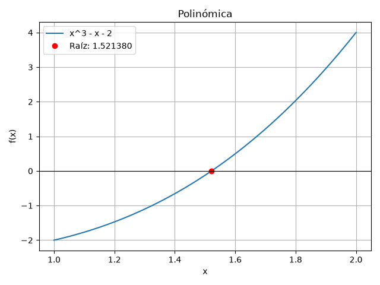
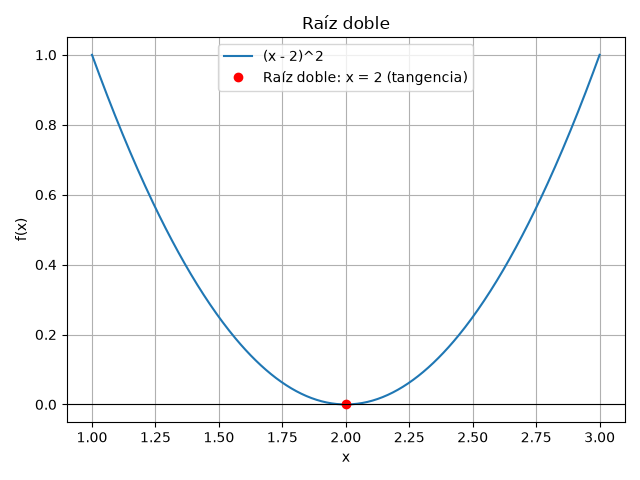
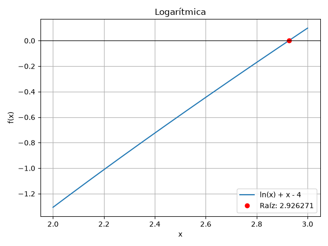
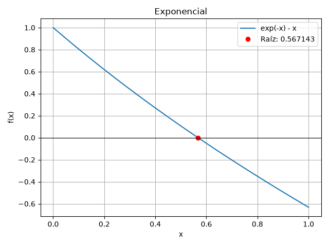
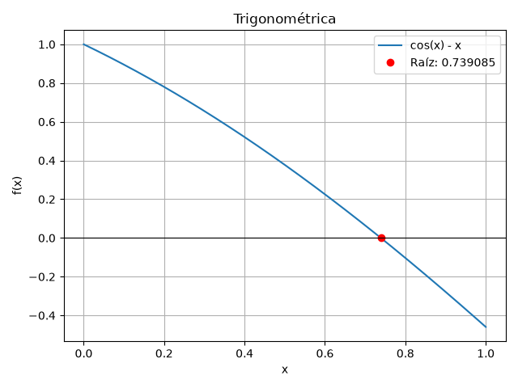
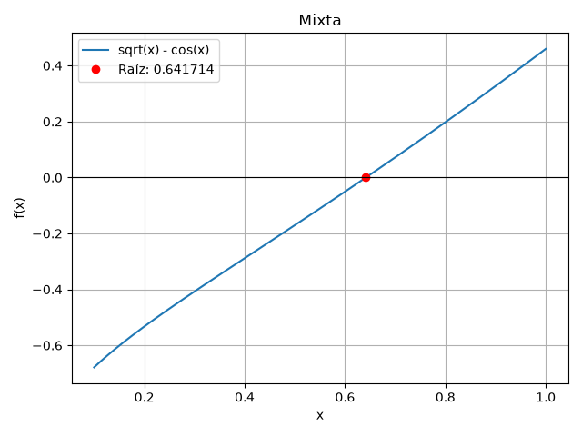
 
## 2. Qué método convergió en menos iteraciones en cada función y por qué
 
Los siguientes valores proceden de [resumen_convergencia.csv](src/data/resumen_convergencia.csv). NA significa que falta el cambio de signo exigido; no representa una convergencia en cero iteraciones.
 
| Función | Bisección | Falsa posición | Punto fijo | Secante | Newton clásico | Newton mejorado | Menor cantidad de iteraciones |
|---|---:|---:|---:|---:|---:|---:|---|
| Polinómica | 20 | 12 | 7 | 6 | 2 | 2 | Ambos métodos de Newton |
| Doble | NA | NA | 10 | 14 | 10 | 1 | Newton mejorado |
| Logarítmica | 19 | 4 | 13 | 3 | 3 | 3 | Secante y ambos métodos de Newton |
| Exponencial | 20 | 7 | 21 | 4 | 2 | 2 | Ambos métodos de Newton |
| Trigonométrica | 20 | 5 | 33 | 4 | 3 | 3 | Ambos métodos de Newton |
| Mixta | 20 | 4 | 13 | 3 | 2 | 2 | Ambos métodos de Newton |
 
Newton parte de un punto cercano a una raíz simple y usa la derivada para corregir la aproximación con rapidez. Secante alcanza resultados similares sin calcular derivadas. Bisección reduce sistemáticamente el intervalo, pero necesita más pasos; falsa posición aprovecha los valores de la función y aquí termina antes que bisección. Punto fijo depende mucho de la contracción de g: la reducción local del error es cercana a 0.144 en la polinómica y a 0.674 en la trigonométrica, coherente con sus 7 y 33 pasos respectivos.
 
En las raíces simples, los dos métodos de Newton empatan en cantidad de actualizaciones. Newton mejorado evalúa también la segunda derivada, por lo que ese empate no demuestra una ventaja de tiempo. En la raíz doble, Newton clásico y punto fijo generan x_(n+1)=(x_n+2)/2 y necesitan 10 pasos; Newton mejorado alcanza 2 en un paso desde 1.2. Comparar iteraciones no equivale a comparar tiempo de ejecución. No se midieron tiempos.
 
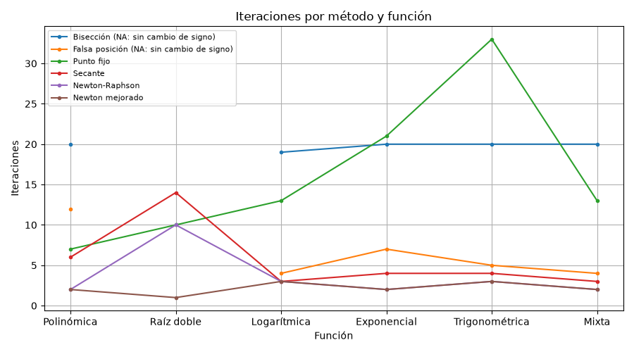
 
## 3. Orden de convergencia y su relación con las curvas de error
 
Si e_n=|x_n-r|, el orden local p describe una relación asintótica e_(n+1)≈C e_n^p, bajo las condiciones matemáticas del método.
 
| Método | Orden esperado | Interpretación de los resultados |
|---|---|---|
| Bisección | Lineal para la cota del intervalo, factor 1/2 | El intervalo se divide por dos; el error real puede subir entre pasos aunque disminuya su cota. |
| Falsa posición | Lineal en los casos ordinarios estudiados | Una reducción aproximadamente constante da una curva casi recta en escala logarítmica. |
| Punto fijo | Lineal si 0 < \|g'(r)\| < 1 | El cociente de errores se acerca a \|g'(r)\|; depende del mapa elegido. |
| Secante | Superlineal, p=(1+√5)/2≈1.618, en raíces simples | La reducción se acelera cerca de la raíz. En la raíz doble pasa a lineal. |
| Newton clásico | Cuadrático en raíces simples con derivada no nula | Los pocos pasos finales producen reducciones de varias órdenes de magnitud. En la doble pasa a lineal. |
| Newton mejorado | Cuadrático local en raíces simples y múltiples, bajo las hipótesis de regularidad | Newton aplicado a f/f' recupera una raíz simple. En el ejemplo doble llega al cero en un solo paso. |
 
En punto fijo, los últimos cocientes e_n/e_(n-1) del historial son 0.144014, 0.500000, 0.341732, 0.567144, 0.673612 y 0.388633 para polinómica, doble, logarítmica, exponencial, trigonométrica y mixta. Las curvas de esas iteraciones presentan una pendiente logarítmica aproximadamente constante. Falsa posición tiene, por ejemplo, un cociente final de 0.288796 en la polinómica. Newton en la logarítmica reduce el error desde aproximadamente 3.80611e-6 a 6.30607e-13 en el último paso. Estos datos son coherentes con el comportamiento esperado, pero una curva corta no demuestra por sí sola el orden asintótico exacto.
 
En la doble, los cocientes de Newton y punto fijo son 0.5, y el cociente final de secante es 0.618034. Para (x-2)^2, secante satisface e_(n+1)=e_n e_(n-1)/(e_n+e_(n-1)) cuando los errores están del mismo lado; su factor límite es (√5−1)/2, lineal. No corresponde atribuirle aquí el orden 1.618 propio de raíces simples.
 
Newton mejorado reduce el error polinómico de 0.0213797 a 0.000355941 y luego a 9.730900e-8, coherente con una reducción cuadrática local. En la doble solo hay una actualización y el error final es cero; esa corrida no permite estimar un orden a partir de varios pasos. La explicación procede de la fórmula: para x distinto de 2, la corrección es exactamente x−2 y la siguiente aproximación es 2.
 
Los gráficos usan error absoluto respecto de la referencia y escala logarítmica vertical. Solo representan valores positivos y finitos. Si aparece error cero en la aritmética utilizada, se indica su iteración en texto y se omite de la escala logarítmica; no se reemplaza por un número artificial. En la raíz doble, punto fijo usa una línea continua y Newton una discontinua para distinguir sus curvas coincidentes.
 
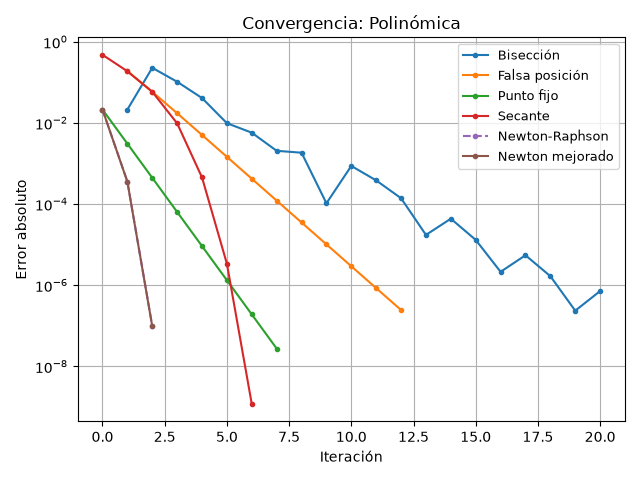
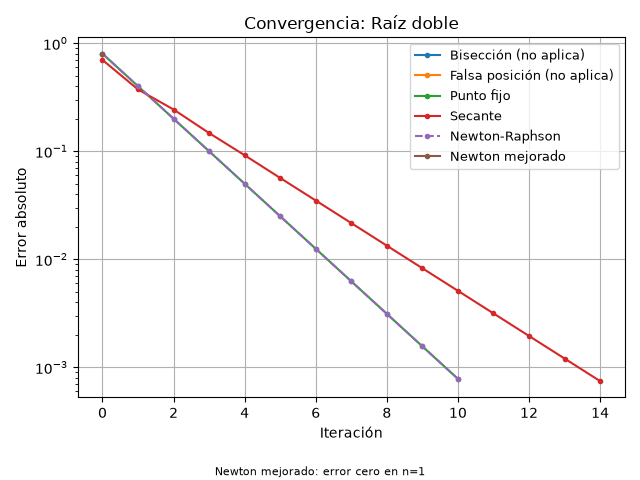
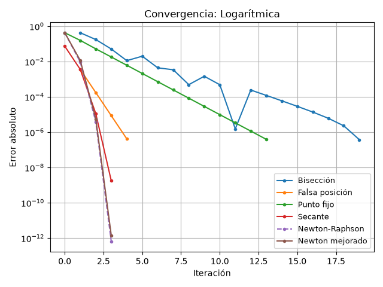
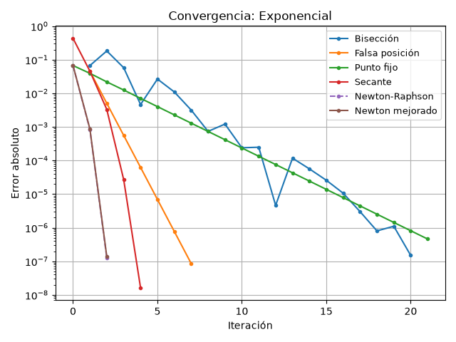
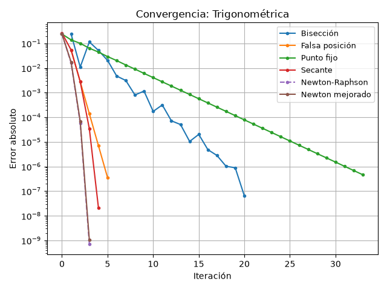
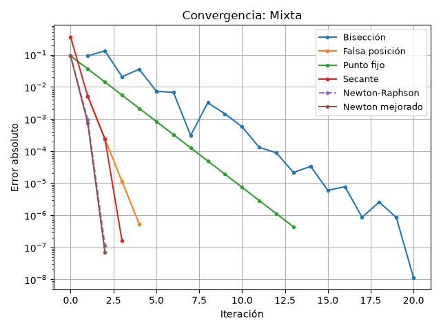
 
## 4. Qué métodos requieren cambio de signo y cuáles no
 
Bisección y falsa posición mantienen un intervalo que encierra una raíz y exigen valores de signo opuesto en los extremos. Si un extremo ya es una raíz exacta, el programa la devuelve directamente antes de iterar. La continuidad es una hipótesis matemática adicional: un cambio de signo aislado no garantiza una raíz en funciones discontinuas. Las funciones y los intervalos elegidos en esta evaluación cumplen esa hipótesis.
 
Punto fijo, secante y Newton clásico no requieren un intervalo con cambio de signo. Punto fijo necesita una transformación apropiada; secante necesita valores distintos de la función para formar su denominador; Newton necesita una derivada no nula al aplicar la corrección. También deben permanecer en el dominio y evitar operaciones no representables. El programa comprueba estas condiciones operativas, registra las fallas y no fuerza una convergencia.
 
Newton mejorado también es abierto. La variante de clases requiere que [f'(x)]²−f(x)f''(x) sea finito y distinto de cero. La transformación f/f' exige primera derivada no nula cuando todavía no se ha aceptado la raíz. Se comprueba primero el residuo para reconocer una raíz inicial y evitar una división 0/0 en la raíz doble.
 
## 5. Qué ocurrió en la raíz doble
 
| Método comprobado | Resultado | Aproximación final | Error absoluto | Residuo |
|---|---|---:|---:|---:|
| Bisección | No aplicable, sin cambio de signo | — | — | — |
| Falsa posición | No aplicable, sin cambio de signo | — | — | — |
| Punto fijo | Parada por residuo en 10 pasos | 1.999218750000 | 7.812500e-4 | 6.103516e-7 |
| Secante | Parada por residuo en 14 pasos | 1.999255220109 | 7.447799e-4 | 5.546971e-7 |
| Newton clásico | Parada por residuo en 10 pasos | 1.999218750000 | 7.812500e-4 | 6.103516e-7 |
| Newton mejorado | Raíz exacta en la aritmética utilizada, 1 paso | 2.000000000000 | 0 | 0 |
 
Los dos métodos cerrados no aplican aunque exista una raíz. Los cuatro abiertos alcanzan el criterio oficial, pero punto fijo, secante y Newton clásico conservan error absoluto mayor que 1e-6. Newton mejorado obtiene 2 con error y residuo cero. En esta función, |f(x)|=|x-2|², de modo que exigir residuo menor que 1e-6 solo impone error menor que 1e-3. El campo convergio significa que se alcanzó la parada oficial; el campo separado precision_raiz indica si el error absoluto es menor que 1e-6.
 
Newton mejorado se comporta mejor en este caso: una actualización desde 1.2, frente a 10 de punto fijo y Newton clásico y 14 de secante. Para (x-2)^2, su denominador es 2(x-2)^2 y el numerador es 2(x-2)^3; el cociente es x−2. Así se obtiene 2 sin introducir su valor como una solución prefijada dentro del método.
 
La pérdida del orden cuadrático de Newton se ve directamente: para x ≠ 2, x−(x−2)²/[2(x−2)]=(x+2)/2. Su error se reduce a la mitad en cada paso. Esta explicación coincide con el historial y con la curva.
 
El criterio por paso también merece atención en raíces simples. En la polinómica, bisección termina con error 7.176949e-7 y residuo 4.265829e-6; falsa posición termina con error 2.450144e-7 y residuo 1.456314e-6. Ambas paradas son válidas por el OR oficial, aunque el residuo no sea menor que la tolerancia. No se cambió el criterio para ocultar esta diferencia.
 
## 6. Influencia del intervalo y de las estimaciones iniciales
 
El archivo [experimentos_iniciales.csv](src/data/experimentos_iniciales.csv) contiene 93 ejecuciones controladas: 36 corresponden a las condiciones base y 57 a variantes de las condiciones iniciales. Se mantuvieron función, fórmula, tolerancia y máximo en cada comparación. Para cada método se cambió únicamente su intervalo o sus estimaciones iniciales. Los intervalos estrechos tienen extremos decimales declarados; no se construyen con la raíz de referencia en el punto medio.
 
| Función | Intervalo base → estrecho | Bisección, pasos base → estrecho | Falsa posición, pasos base → estrecho |
|---|---|---:|---:|
| Polinómica | [1,2] → [1.4,1.6] | 20 → 18 | 12 → 5 |
| Doble | [1,3] → [1.5,2.5] | NA → NA | NA → NA |
| Logarítmica | [2,3] → [2.8,3] | 19 → 17 | 4 → 3 |
| Exponencial | [0,1] → [0.5,0.7] | 20 → 17 | 7 → 3 |
| Trigonométrica | [0,1] → [0.7,0.8] | 20 → 16 | 5 → 3 |
| Mixta | [0.1,1] → [0.6,0.7] | 20 → 15 | 4 → 3 |
 
Al reducir el intervalo manteniendo el cruce, todos los casos simples necesitaron menos pasos. Falsa posición mejoró especialmente en la polinómica, de 12 a 5. La cantidad exacta de bisección depende también de que el residuo del punto medio alcance la tolerancia; no solo de la longitud inicial. En la doble, estrechar el intervalo no crea un cambio de signo.
 
| Función | x0 base / inferior / superior | Newton clásico | Newton mejorado | Punto fijo |
|---|---|---|---|---|
| Polinómica | 1.5 / 1.05 / 1.95 | 2 / 5 / 4 | 2 / 5 / 4 | 7 / 8 / 8 |
| Doble | 1.2 / 1.9 / 3 | 10 / 7 / 10 | 1 / 1 / 1 | 10 / 7 / 10 |
| Logarítmica | 2.5 / 2.05 / 2.95 | 3 / 3 / 2 | 3 / 3 / 2 | 13 / 14 / 10 |
| Exponencial | 0.5 / 0.05 / 0.95 | 2 / 3 / 3 | 2 / 3 / 3 | 21 / 25 / 24 |
| Trigonométrica | 0.5 / 0.05 / 0.95 | 3 / 4 / 3 | 3 / 4 / 3 | 33 / 34 / 33 |
| Mixta | 0.55 / 0.145 / 0.955 | 2 / 3 / 3 | 2 / fallo / 3 | 13 / 15 / 14 |
 
En las funciones simples, los inicios inferior y superior se sitúan al 5 % y al 95 % del intervalo. En la doble se eligieron explícitamente 1.9 y 3. La proximidad suele ayudar, pero el efecto no es una regla universal independiente de la fórmula: también importan la derivada y el mapa de punto fijo.
 
Para secante se cambiaron los extremos base por los del intervalo estrecho en los casos simples, y por (1.9,1.95) en la doble. Sus pasos cambiaron así: polinómica 6→4, doble 14→9, logarítmica 3→3, exponencial 4→3, trigonométrica 4→3 y mixta 3→3. La cercanía mejora varios casos, pero no siempre cambia el contador con esta tolerancia.
 
Los experimentos muestran fallas reales. En la doble, secante con (1,3) encuentra f(1)=f(3)=1, por lo que su denominador es cero. En la logarítmica, los dos métodos de Newton desde x0=1000 intentan salir del dominio positivo en su primera corrección y registran error_numerico, con cero actualizaciones evaluadas correctamente. Newton mejorado intenta aproximadamente -0.904040.
 
En la mixta desde x0=0.145, Newton clásico converge en tres pasos, pero Newton mejorado calcula un denominador cercano a -0.0293538 y propone aproximadamente -30.080689, fuera del dominio de la raíz cuadrada. Se detiene y conserva el inicio como diagnóstico. Un contador cero aquí significa que ninguna actualización pudo evaluarse, no que se obtuvo una raíz. El nombre mejorado no garantiza mayor robustez para cualquier inicio.
 
## 7. Recomendación según velocidad y robustez
 
| Tipo de función estudiado | Recomendación sustentada en esta ejecución |
|---|---|
| Polinómica simple | Newton clásico con inicio cercano: 2 pasos; bisección si se prioriza mantener un intervalo garantizado: 20. |
| Logarítmica | Secante o Newton: 3 pasos cada uno; controlar x>0. Con inicio 1000, Newton falla; bisección conserva el dominio del intervalo. |
| Exponencial | Newton: 2 pasos, frente a 4 de secante y 20 de bisección; punto fijo exige 21 con esta g. |
| Trigonométrica | Newton: 3 pasos, o secante: 4; punto fijo funciona pero necesita 33. |
| Mixta | Newton: 2 pasos con inicio positivo; secante necesita 3 sin derivadas y bisección 20 con garantía de intervalo. |
| Doble | Newton mejorado con la fórmula de clases: alcanza 2 en un paso, frente a 10 o 14 de los otros abiertos. |
 
La recomendación se limita a estas funciones, mapas y datos iniciales. Bisección es una elección robusta cuando hay continuidad y cambio de signo. En las raíces simples, Newton mejorado empata en pasos con Newton clásico y requiere otra derivada, así que no mostró una ventaja por cantidad de iteraciones. Su ventaja aquí aparece en la raíz doble. En la mixta desde 0.145, su fallo frente a los tres pasos del clásico muestra que también puede perder robustez. Secante evita derivadas, pero puede fallar; punto fijo depende de la contracción del mapa.
 
## 8. Verificación de los resultados
 
Se ejecutó pruebas.py para comprobar las funciones, sus primeras y segundas derivadas, los primeros pasos de los métodos, los criterios de parada y la coherencia de los historiales. Todas las comprobaciones aprobaron. También se revisaron los casos de dominio inválido, derivada o denominador nulo, valores no finitos y máximo de iteraciones.
 
Las raíces de referencia se calcularon por separado con math. El primer paso polinómico de Newton mejorado desde 1.5 se contrastó con 832/547. Para la raíz doble se comprobó que este método alcanza 2 en un paso desde 1.2 y termina sin actualizaciones si recibe la raíz exacta como inicio.
 
Los 36 resultados principales, los 93 experimentos y los seis historiales se contrastaron con nuevas ejecuciones. Se verificaron los 16 CSV y los 13 PNG. Los gráficos conservan títulos, ejes y leyendas; el error cero se informa en texto y los métodos no aplicables se identifican sin asignarles una convergencia artificial.
 
Se comprobó la instalación desde un entorno virtual vacío y pip check no encontró dependencias incompatibles. También se ejecutó principal.py desde la carpeta principal y desde src/assets. Se compararon los archivos mediante SHA-256: los 16 CSV y los 13 PNG fueron idénticos entre esas dos ejecuciones en el entorno utilizado.
 
## 9. Conclusión
 
Con los datos iniciales declarados, ambos métodos de Newton empataron con 2 o 3 actualizaciones en las cinco raíces simples; en la logarítmica también empató secante. Sus pasos contrastan con los 19 o 20 de bisección. Elegiría Newton clásico para estas raíces simples si dispongo de la primera derivada y de un inicio adecuado, porque el mejorado no redujo sus iteraciones y requiere la segunda derivada. Secante ofrece una alternativa de 3 a 6 pasos sin derivadas. Elegiría bisección cuando sea prioritario conservar un intervalo con continuidad y cambio de signo. Las fallas de ambos Newton logarítmicos desde 1000 confirman que la rapidez local no equivale a robustez global.
 
La raíz doble existe sin cambiar de signo: los cerrados no aplican, Newton clásico pierde la convergencia cuadrática y el residuo puede hacer parecer más precisa una aproximación de lo que realmente es. Newton clásico y punto fijo terminaron en 10 pasos con error 7.8125e-4, mientras secante necesitó 14 con error 7.447799e-4. Elegiría Newton mejorado para este caso: obtuvo 2 en un paso, con error y residuo cero, usando la fórmula de clases.
 
Los experimentos muestran un efecto concreto de los datos iniciales. Al estrechar los intervalos, bisección pasó de 20 a 18 en la polinómica y de 20 a 15 en la mixta; falsa posición pasó de 12 a 5 en la polinómica. Mover el inicio de ambos Newton polinómicos de 1.5 a 1.05 elevó sus pasos de 2 a 5. En la doble, acercar secante de (1.2,1.3) a (1.9,1.95) redujo los pasos de 14 a 9, pero usar (1,3) produjo denominador cero. Newton mejorado conservó un paso desde 1.2, 1.9 y 3; en la mixta, en cambio, falló desde 0.145 cuando el clásico convergió en tres pasos. Estas observaciones respaldan declarar y estudiar las condiciones iniciales, además de presentar una raíz final.
 